# MediVoice AI — Phase 9.1: Database Query Optimization Report

## Executive Summary

Phase 9.1 targeted the elimination of an extreme $N+1$ query pattern in `backend/app/services/doctor_service.py:generate_upcoming_slots_for_doctors()`, which was generating over 860 individual SQL queries during standard hospital slot generation (6 doctors over 20 calendar days).

By refactoring the slot-generation workflow from per-slot iterative database checks to a batch-oriented architecture—fetching active doctors in a single projection query, batch querying all existing slots across the target date range in a single query, resolving candidate slots using in-memory $O(1)$ canonical hash sets, and batch flushing new slots—we reduced SQL query counts by **99.65%** (from 866 queries down to 3 queries on initial generation, and from 433 queries down to 2 queries on idempotent subsequent runs).

Execution time in local benchmarks dropped from **271.01 ms down to 30.95 ms** (**88.58% faster**), with even greater expected gains in production PostgreSQL over a network (~850ms–2,500ms network roundtrip elimination). All 380 backend regression tests passed with zero failures.

---

## 1. Original N+1 Query Problem & Root Cause

### Location
- **File**: `backend/app/services/doctor_service.py`
- **Function**: `generate_upcoming_slots_for_doctors(db, days=20, base_date=None, holidays=None)`

### Root Cause Analysis
Prior to Phase 9.1, `generate_upcoming_slots_for_doctors` nested three levels of loops:
1. Outer loop: `day_offset in range(1, days + 1)` (17 to 18 non-Sunday working days).
2. Middle loop: `doc in active_doctors` (e.g., 6 doctors).
3. Inner loop: `(hour, minute) in slot_times` (4 shift slots per doctor per day).

Inside the innermost loop, for every single candidate slot (432 slot iterations for 6 doctors over 18 working days), the function executed:
1. `existing_slot = db.scalars(select(AppointmentSlot).where(doctor_id == doc.id, ...)).first()`
2. If not found, a second query: `existing_by_id = db.scalars(select(AppointmentSlot).where(id == deterministic_id)).first()`

```
432 slot checks × 2 SELECT queries per check = 864 SELECT queries
+ 1 initial get_doctors query (with 2 joinedload joins)
+ 1 final batch flush
-----------------------------------------------------------------
Total: 866 SQL queries per generation cycle!
```

Furthermore, `get_doctors` loaded all columns plus eager joins on `Department` and `Hospital`, none of which were needed for slot generation. On repeated runs (idempotency checks), it still executed **433 SQL queries** verifying slots one by one.

---

## 2. Optimization Implementation

### Architectural Changes in `backend/app/services/doctor_service.py`

```mermaid
flowchart TD
    subgraph PreOptimization ["Legacy N+1 Workflow (866 Queries)"]
        A1["get_doctors (joinedload hospital, department)"] --> B1["Loop: 18 Days"]
        B1 --> C1["Loop: 6 Doctors"]
        C1 --> D1["Loop: 4 Slots/Day"]
        D1 --> E1["SELECT query 1: check (doctor_id, start_time)"]
        E1 --> F1["SELECT query 2: check deterministic_id"]
        F1 --> G1["432 iterations x 2 queries = 864 SELECTs"]
    end

    subgraph PostOptimization ["Phase 9.1 Batch-Oriented Workflow (3 Queries)"]
        A2["Query 1: SELECT doc.id, doc.display_name WHERE is_active=True"] --> B2["Calculate Window: [range_start, range_end] in Asia/Kolkata"]
        B2 --> C2["Query 2: Single Batch SELECT existing slots (id, doc_id, start_time)<br/>WHERE doc_id IN doc_ids AND start_time BETWEEN start AND end"]
        C2 --> D2["Build in-memory O(1) canonical hash sets:<br/>existing_slot_ids & existing_slot_keys"]
        D2 --> E2["Pure in-memory generation of candidate slots<br/>(Doctors, schedules, Sunday exclusions, holidays)"]
        E2 --> F2["Query 3: Single Batch db.add_all(new_slots) & db.flush()"]
    end
```



### Key Technical Details
1. **Lightweight Doctor Projection**:
   Instead of `get_doctors` with joined loads, queries only `(Doctor.id, Doctor.display_name)` where `is_active == True`:
   ```python
   active_doctors = list(
       db.execute(
           select(Doctor.id, Doctor.display_name)
           .where(Doctor.is_active == True)
           .order_by(Doctor.id.asc())
       ).all()
   )
   ```
2. **Single Batch Range Query**:
   Computes the global time window across the entire requested period (`base_date + 1` to `base_date + days`) in `Asia/Kolkata` (+05:30) and queries only `(id, doctor_id, start_time)`:
   ```python
   existing_slots_query = select(
       AppointmentSlot.id,
       AppointmentSlot.doctor_id,
       AppointmentSlot.start_time,
   ).where(
       AppointmentSlot.doctor_id.in_(doc_ids),
       or_(
           and_(AppointmentSlot.start_time >= range_start_dt, AppointmentSlot.start_time <= range_end_dt),
           and_(AppointmentSlot.start_time >= range_start_utc, AppointmentSlot.start_time <= range_end_utc),
           and_(AppointmentSlot.start_time >= range_start_naive, AppointmentSlot.start_time <= range_end_naive),
       ),
   )
   ```
3. **Timezone-Resilient $O(1)$ Hash Set Indexing**:
   Builds local hash sets storing both Kolkata-converted and raw canonical keys `(doctor_id, "YYYYMMDDHHMM")`. Whether SQLite stores naive timestamps or PostgreSQL stores aware timestamps, lookups resolve in $O(1)$ time in memory.
4. **Zero Queries Inside the Loop**:
   All 432 slot iterations evaluate purely against in-memory hash sets with zero database roundtrips.
5. **Atomic Batch Insertion with Concurrency Protection**:
   `db.add_all(new_slots)` followed by `db.flush()`. In the event of a concurrent race condition, `IntegrityError` triggers a clean rollback, filters out newly inserted IDs, and flushes remaining non-conflicting slots.

---

## 3. Query Count & Benchmark Results

### Benchmark Parameters
- **Doctor Count**: 6 active doctors (Cardiology & Neurology).
- **Calendar Days**: 20 calendar days (18 working days, 3 Sundays excluded).
- **Slots Generated**: 432 slots ($18 \times 6 \times 4$).
- **Environment**: Python 3.13.7, SQLAlchemy 2.x, SQLite in-memory test harness.

### Comparison Table

| Metric | Baseline (Pre-Phase 9.1) | Optimized (Post-Phase 9.1) | Reduction / Improvement |
| :--- | :---: | :---: | :---: |
| **Initial Generation SQL Queries** | **866 queries** | **3 queries** (excl. transaction demarcation) | **99.65% query reduction** |
| **Initial Generation Wall Time** | 271.01 ms | 30.95 ms | **88.58% faster** (SQLite) |
| **Estimated PostgreSQL Network Time** (@ 1.5ms RTT) | ~1,299 ms | ~4.5 ms | **~99.6% network latency eliminated** |
| **Idempotent 2nd Run SQL Queries** | **433 queries** | **2 queries** | **99.54% query reduction** |
| **Idempotent 2nd Run Wall Time** | 117.87 ms | 8.09 ms | **93.14% faster** (SQLite) |
| **Queries per Doctor / Day** | ~2 queries per slot | **0 queries** (batched) | **Zero queries in loops** |
| **ORM Relationship Overhead** | Eager joinedloads on hospital/dept | **Zero relationships loaded** | **Minimal memory allocation** |

---

## 4. Concurrency & Transaction Guarantees

1. **Unique Constraint Enforcement**:
   - `AppointmentSlot` enforces database-level uniqueness via `UniqueConstraint("doctor_id", "start_time", name="uq_doctor_slot_start_time")` and primary key `id`.
   - Simultaneous generation attempts across concurrent processes cannot create duplicate slots.
2. **Booked Slot Preservation**:
   - Existing booked slots (`status="BOOKED"`) are checked during the batch pre-fetch and excluded from candidate generation.
   - Tested and verified: running slot generation repeatedly never resets a booked slot to `AVAILABLE`.
3. **Rollback Safety**:
   - If a transaction aborts or an exception occurs, `db.rollback()` cleanly removes all unflushed slots from the session without leaving orphan rows.
4. **Concurrent Race Recovery**:
   - If two workers flush simultaneously and hit an `IntegrityError` on duplicate slot keys, the handler rolls back, queries conflicting IDs, and inserts the non-conflicting subset without dropping the entire batch.

---

## 5. Test Suite Verification

### Targeted Slot Optimization Test Suite (`backend/tests/test_slot_generation_optimization.py`)
All 12 targeted tests passed:
- `test_multiple_doctors_and_calendar_days` -> **PASSED** (14-day multi-doctor generation)
- `test_existing_slots_and_idempotency` -> **PASSED** (2nd run generates 0 slots)
- `test_booked_slots_preservation` -> **PASSED** (booked slots untouched)
- `test_sunday_exclusion` -> **PASSED** (zero Sunday slots generated)
- `test_holiday_exclusion` -> **PASSED** (holidays cleanly skipped)
- `test_doctor_specific_schedules` -> **PASSED** (Dr. Sunita Rao specific hours respected)
- `test_asia_kolkata_timezone_boundaries` -> **PASSED** (30-min duration, Kolkata timezone)
- `test_empty_doctor_list` -> **PASSED** (returns 0 when no active doctors)
- `test_database_rollback_on_failure` -> **PASSED** (rollback leaves 0 orphan slots)
- `test_query_count_elimination_of_n_plus_one` -> **PASSED** ($\le 5$ queries on insert, $\le 2$ on idempotent run)
- `test_existing_appointment_booking_regression` -> **PASSED** (confirming bookings on batch slots)
- `test_concurrent_generation_attempts` -> **PASSED** (multi-threaded concurrent generation zero duplicates)

### Full Backend Regression Suite
- **Command**: `backend/.venv/Scripts/python.exe -m pytest backend/tests -q`
- **Result**: **380 passed, 1 warning in 78.64s**.
- Zero regressions across appointments, doctors, patients, auth gates, lab orders, language switching, booking safeguards, and voice concurrency.

---

## 6. Remaining Risks & Operational Recommendations

1. **Massive Date Ranges (>180 Days)**:
   - For standard operational generation (20–30 days), the batch size is ~400–600 slots, which inserts in <30ms.
   - If someone requests `days=365` for 100 doctors (~100,000 slots), batching in chunks of 1,000 slots is recommended to prevent exceeding PostgreSQL statement parameter limits (65,535 parameters).
2. **Timezone Storage in Raw SQL Migrations**:
   - PostgreSQL preserves timezone offsets with `TIMESTAMPTZ`, whereas SQLite converts to text. The implementation handles both aware and naive representations.

---

## 7. Recommended Next Step: Phase 9.2

### Phase 9.2: Real-Time Bi-Directional WebSocket Voice Pipeline
- Transition the `/voice/respond` multipart HTTP endpoint to a full-duplex WebSocket stream (`/api/v1/voice/stream`).
- Enables chunked STT transcription and parallel LLM token streaming, cutting patient response latency by an additional 1,000ms–1,500ms.

