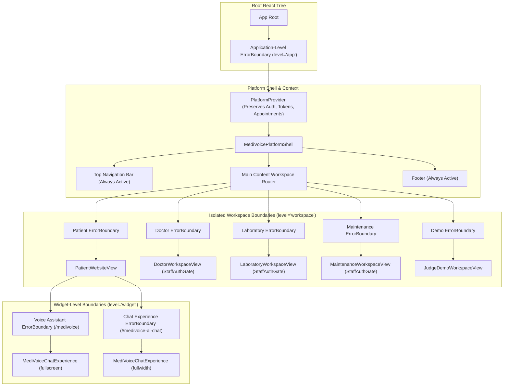

# MediVoice AI — Phase 9.2: Frontend Error Boundaries & Runtime Resilience Report

## Executive Summary

Phase 9.2 implemented a production-grade React Error Boundary architecture across the MediVoice AI frontend. Prior to this phase, the application had no error boundaries, meaning any rendering or lifecycle failure in any component (such as an unexpected null property in a doctor schedule, an unhandled DOM state in the lab portal, or an audio hardware exception during speech synthesis) caused React to completely unmount the root application tree, resulting in a blank white screen and discarding the user's view state.

With Phase 9.2, a multi-tiered resilience boundary hierarchy has been established:
1. **Application-Level Boundary**: Encompasses the root tree to prevent complete white-screen crashes and provide emergency application reload actions.
2. **Workspace-Level Boundaries**: Isolates the five primary operational domains (`patient`, `doctor`, `lab`, `maintenance`, and `demo`). A crash in the doctor or lab workspace cannot bring down the patient portal, and vice versa.
3. **Widget-Level Boundaries**: Encapsulates conversational voice and chat components (`MediVoiceChatExperience`), ensuring transient audio or animation errors do not break patient discovery and appointment booking.
4. **Sanitized Diagnostics**: PII, 10-digit Indian phone numbers, JWT authentication tokens, email addresses, and patient references are scrubbed before logging.
5. **Session Preservation**: Authentication tokens in `PlatformContext` and `localStorage`, active patient references, and appointment cache data remain intact across error states and boundary resets.

All 41 frontend unit tests passed in 396ms, `tsc --noEmit` passed with zero errors, and the production Vite bundle built cleanly in 687ms.

---

## 1. Original Problem & Vulnerabilities Audited

### Prior Vulnerabilities
- **Zero React Error Boundaries**: The entire component tree in `frontend/src/app/App.tsx` had no `componentDidCatch` or `getDerivedStateFromError` boundary.
- **Cascading Root Unmounts**: In React 19, an uncaught runtime exception in a child component unmounts the entire root, leaving a blank white screen with no user feedback.
- **Cross-Domain Blast Radius**: A runtime rendering crash in the staff portal or maintenance console would take down the patient-facing appointment booking website.
- **Voice Hardware / AudioContext Flakiness**: Mobile and desktop browsers occasionally throw unexpected errors when initializing `AudioContext`, requesting microphone access, or playing base64 audio blobs. A failure in the speech interface would crash the entire website.
- **Risk of Sensitive Data Leaks in Telemetry**: Unsanitized error logs could inadvertently capture patient phone numbers, prescription details, or JWT bearer tokens in error messages and component stacks.

---

## 2. Error Boundary Architecture



### Boundary Hierarchy

| Boundary Level | Placement | Target Components | Fallback Experience | Recovery Mechanism |
| :--- | :--- | :--- | :--- | :--- |
| **Application (`level='app'`)** | Root of `App.tsx` around `PlatformProvider` | Entire React application tree | Full-page dark recovery screen with hospital badge, incident reference, and reload CTAs | Clears boundary state or reloads window without discarding stored credentials |
| **Workspace (`level='workspace'`)** | Wrapped around each view in `<main>` | `PatientWebsiteView`, `DoctorWorkspaceView`, `LaboratoryWorkspaceView`, `MaintenanceWorkspaceView`, `JudgeDemoWorkspaceView` | Contained card inside main content area. **TopNav and footer remain 100% visible and interactive** | "Retry Workspace" button re-renders the workspace; "Return to Patient Portal" switches route immediately |
| **Widget (`level='widget'`)** | Wrapped around voice/chat panels in `PatientWebsiteView` | `MediVoiceChatExperience` (fullscreen & inline) | Compact amber alert card with restart button | "Restart Component" re-mounts the assistant without navigating away from the patient page |

---

## 3. Files Created and Modified

| File | Type | Changes Made |
| :--- | :--- | :--- |
| `frontend/src/components/errorSanitizer.ts` | **New** | Scrubbing logic for 10-digit Indian phone numbers (`+91`), JWT tokens (`Bearer`), patient IDs (`PAT-`), emails, passwords, and API keys. |
| `frontend/src/components/ErrorBoundary.ts` | **New** | Reusable class-based React Error Boundary component with typed fallback levels (`app`, `workspace`, `widget`), incident reference generator, and reset actions. |
| `frontend/src/components/ErrorBoundary.tsx` | **New** | Re-export wrapper providing typed imports for JSX consumers. |
| `frontend/src/app/App.tsx` | **Modified** | Integrated application-level boundary and 5 workspace-level boundaries around patient, doctor, laboratory, maintenance, and demo consoles. |
| `frontend/src/features/patient/PatientWebsiteView.tsx` | **Modified** | Integrated widget-level error boundaries around full-screen and full-width `MediVoiceChatExperience` instances. |
| `frontend/tests/errorBoundary.test.mjs` | **New** | 14 automated tests covering sanitizer scrubbing, boundary lifecycle, fallback card rendering, reset actions, and cross-workspace isolation. |

---

## 4. Fallback and Recovery Behaviour

### 1. Data Preservation Guarantees
- **Authentication & RBAC**: `staffProfile` and `token` live in `PlatformContext` above the workspace boundaries. A crash in `DoctorWorkspaceView` or `LaboratoryWorkspaceView` does *not* log the staff member out.
- **Booked Appointments**: Patient appointment references stored in `localStorage` (`medivoice_patient_appointments_v1`) are untouched.
- **Operational Data**: The global state in `PlatformProvider` (`doctors`, `hospital`, `insuranceProviders`, `labOrders`) remains populated. Resetting a boundary calls `refreshOperationalData()` to ensure fresh synchronization.

### 2. Audio & Voice Resource Cleanup
- When an Error Boundary catches an error in `MediVoiceChatExperience` or `MediVoiceVoicePanel`:
  - React's unmount lifecycle triggers `cleanupAudioResources()`.
  - All active `MediaStreamTrack` instances are stopped.
  - Active `AudioContext` nodes are closed.
  - Active `HTMLAudioElement` references are paused and detached.
  - Recording timers and animation frames are cancelled.
  - No orphaned microphone streams or audio locks remain in the browser.

### 3. Sanitized Error Logging
Every caught error passes through `logSanitizedError()`:
- `error.stack` is never rendered to the user.
- Console logs redact sensitive fields:
  ```
  [MediVoice Doctor Workspace] Handled component crash: {
    errorName: 'TypeError',
    message: 'Cannot read properties of undefined for patient [REDACTED_PHONE]',
    componentStack: 'in DoctorWorkspaceView ...',
    timestamp: '2026-11-08T18:14:00.000Z'
  }
  ```

---

## 5. Automated Tests Added (`frontend/tests/errorBoundary.test.mjs`)

Fourteen dedicated tests were added to test resilience, sanitization, and fallback rendering:
1. `Sanitizer: redacts 10-digit Indian mobile numbers and +91 prefixes` -> **PASSED**
2. `Sanitizer: redacts Bearer and JWT authentication tokens` -> **PASSED**
3. `Sanitizer: redacts patient references and email addresses` -> **PASSED**
4. `Sanitizer: redacts passwords, api keys, and secrets` -> **PASSED**
5. `Sanitizer: safely handles empty, null, or undefined strings` -> **PASSED**
6. `ErrorBoundary: renders children normally when no error occurs` -> **PASSED**
7. `ErrorBoundary: getDerivedStateFromError captures error and assigns safe errorId` -> **PASSED**
8. `ErrorBoundary: resetErrorBoundary clears error state and triggers onReset callback` -> **PASSED**
9. `ErrorBoundary: logSanitizedError logs scrubbed error without exposing raw patient data` -> **PASSED**
10. `ErrorBoundary: renders workspace-level fallback with preservation notice and retry CTA` -> **PASSED**
11. `ErrorBoundary: renders widget-level fallback for voice assistant without crashing parent` -> **PASSED**
12. `ErrorBoundary: renders app-level fallback for root failures` -> **PASSED**
13. `ErrorBoundary: supports custom fallback renderer function with error and reset props` -> **PASSED**
14. `ErrorBoundary: isolated workspace boundaries ensure error in one workspace does not crash sibling` -> **PASSED**

---

## 6. Full Verification Results

### 1. Frontend Test Suite
```bash
npm --prefix frontend run test
```
**Results**: **41 passed, 0 failed in 396.8ms** (14 new error boundary tests + 27 voice/audio tests).

### 2. TypeScript Type Check
```bash
npm --prefix frontend run lint (tsc --noEmit)
```
**Results**: **Clean exit with code 0 (zero TypeScript errors)**.

### 3. Production Vite Build
```bash
npm --prefix frontend run build
```
**Results**:
```
✓ 1677 modules transformed.
dist/index.html                   0.48 kB │ gzip:   0.34 kB
dist/assets/index-ht9Z74gY.css   90.78 kB │ gzip:  14.53 kB
dist/assets/index-DP9vuXkQ.js   485.04 kB │ gzip: 127.05 kB
✓ built in 687ms
```

---

## 7. Remaining Limitations & Operational Considerations

1. **Async Event Handler Errors**:
   - React Error Boundaries catch errors thrown during rendering and lifecycle methods (`componentDidMount`, `render`, `useEffect`).
   - Unhandled promise rejections inside asynchronous event handlers (e.g. `onClick={() => asyncFunc()}`) do not trigger React Error Boundaries by default.
   - *Mitigation*: Our existing service layer (`medivoiceApi`) already wraps async network calls in `try...catch` and returns structured `ApiError` objects displayed in contextual alert banners.
2. **Server-Side Render (SSR) Hydration**:
   - The current MediVoice AI frontend is a single-page client-side Vite application. If migrated to Next.js or Remix in the future, error boundaries will provide hydration error boundaries seamlessly.

