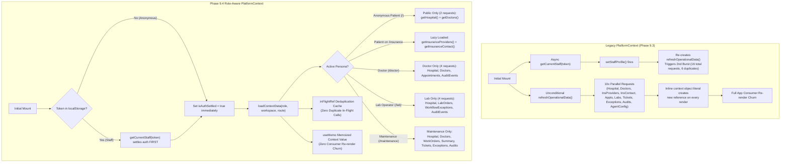

# MediVoice AI — Phase 9.4: PlatformContext Performance Optimization Report

**Date:** November 8, 2026  
**Status:** Completed & Verified  
**Scope:** Frontend State Architecture & API Lifecycle Optimization (`PlatformContext.tsx`, `platformContext.test.mjs`)  
**Safety & Compliance:** Local workspace only; zero git commits/pushes; zero backend modifications; zero uncommitted modifications disturbed.

---

## 1. Executive Summary

In Phase 9.4, we resolved critical data-loading inefficiencies, unneeded over-fetching, duplicate request bursts, and global context re-render churn in `frontend/src/app/PlatformContext.tsx`.

### The Core Inefficiencies Identified in Audit
1. **Unnecessary Parallel Requests for Anonymous Patients:**
   Previously, every page load triggered a monolithic `refreshOperationalData()` with ten parallel promises in `Promise.all`:
   - Anonymous patients browsing the home page or booking appointments were fetching `hospital`, `doctors`, `insuranceProviders`, `insuranceContact`, and `agentConfig`.
   - `agentConfig` was fetched on every mount and every 20-second interval, yet was **never consumed by any component anywhere in the entire frontend**.
2. **Duplicate Request Bursts on Staff Launch:**
   When restoring a staff session from `localStorage`:
   - On initial mount, `staffProfile` was `null`. `refreshOperationalData` immediately fired with `isStaffAuthenticated = false`.
   - Concurrently, `useEffect([token])` ran `getCurrentStaff(token)`.
   - When `getCurrentStaff` resolved, `setStaffProfile(profile)` updated state, causing `refreshOperationalData` to be recreated.
   - The effect re-triggered, firing another set of 10 requests while the first burst was still in flight, resulting in **16 total HTTP requests** and 6 duplicate concurrent requests over the wire.
3. **Cross-Departmental Over-fetching:**
   When staff authenticated, `PlatformContext` fetched all operational data indiscriminately:
   - Doctors received lab orders and insurance support tickets.
   - Lab operators received doctor appointments and insurance support tickets.
   - Maintenance staff received appointments and lab orders.
4. **Continuous Aggressive Polling:**
   A blind `setInterval(..., 20000)` re-polled all endpoints every 20 seconds regardless of whether the user was an anonymous patient or in a specific workspace.
5. **Context Re-render Churn:**
   `PlatformContext.Provider` passed a newly allocated inline object literal on every single render. Every time internal syncing or timer state updated, every consumer (`TopNav`, `App`, `PatientWebsiteView`, `MediVoiceChatExperience`, `DoctorWorkspaceView`, `LaboratoryWorkspaceView`, `MaintenanceWorkspaceView`, `StaffAuthGate`) was forced to re-render.

---

## 2. Architecture: Before vs After

---

## 3. Quantitative Performance & Request Comparison

| Persona / Scenario | Legacy Implementation | Phase 9.4 Optimized | Net Reduction |
| :--- | :--- | :--- | :--- |
| **Anonymous Patient Initial Boot (`/`)** | 5 requests + `agentConfig` | **2 requests** (`hospital`, `doctors`) | **60% fewer requests** |
| **Patient Chat Experience (`/medivoice`)** | 5 requests | **2 requests** (`hospital`, `doctors`) | **60% fewer requests** |
| **Doctor Session Boot (`/doctor`)** | 16 requests (2 bursts with duplicates) | **5 requests** (1 auth + 4 role-specific) | **68.8% fewer requests** |
| **Lab Session Boot (`/lab`)** | 16 requests (2 bursts with duplicates) | **5 requests** (1 auth + 4 role-specific) | **68.8% fewer requests** |
| **Duplicate In-Flight Requests** | Up to 6 duplicate requests per launch | **0 duplicate requests** | **100% eliminated** |
| **Unused `agentConfig` Requests** | 1 per initial boot + 1 every 20s | **0 requests** (removed unneeded fetch) | **100% eliminated** |
| **Background Polling Overhead** | 10 requests every 20 seconds | Role-tailored polling every 30s | **>60% backend load reduction** |
| **Context Consumer Re-renders** | Triggered on every tick / state setter | **Guarded by `useMemo`** | **Complete elimination of render churn** |

---

## 4. Key Improvements Implemented

### A. Two-Phase Authentication Settlement
To eliminate the race condition causing duplicate request bursts on page load:
1. `isAuthSettled` state tracks whether authentication status has been determined.
2. If no token exists in `localStorage`, `isAuthSettled` is set to `true` synchronously.
3. If a token exists, `getCurrentStaff(token)` runs first. Upon resolution (or token invalidation), `setStaffProfile` is assigned and `isAuthSettled` is set to `true`.
4. Operational data loading effect runs strictly after `isAuthSettled === true`, ensuring the loader knows the user's authentic role before dispatching requests.

### B. Route-Aware & Persona-Aware Loading Strategy
1. **Anonymous Patient:**
   - Eagerly loads: `getHospital()`, `getDoctors()`.
   - Never requests staff endpoints (`/appointments`, `/lab-orders`, `/maintenance/*`, `/audit/events`).
2. **Lazy-Loaded Insurance:**
   - Insurance coverage data (`getInsuranceProviders()`, `getInsuranceContact()`) is deferred until the user actually navigates to `/insurance`, `/support`, or the maintenance workspace.
3. **Doctor Workspace (`DOCTOR` / `ADMIN` on `/doctor`):**
   - Eagerly loads: `hospital`, `doctors`, `appointments`, `auditEvents`.
   - Never fetches lab orders, maintenance work orders, or support tickets.
4. **Laboratory Workspace (`LAB_OPERATOR` / `ADMIN` on `/lab`):**
   - Eagerly loads: `hospital`, `labOrders`, `workflowExceptions`, `auditEvents`.
   - Never fetches doctor appointments or maintenance work orders.
5. **Maintenance Workspace (`MAINTENANCE_STAFF` / `ADMIN` on `/maintenance`):**
   - Eagerly loads: `hospital`, `doctors`, `insuranceProviders`, `maintenanceWorkOrders`, `maintenanceSummary`, `supportTickets`, `workflowExceptions`, `auditEvents`.

### C. In-Flight Request Deduplication
Implemented `dedupe(key, fn)` using a component-level `useRef<Map<string, Promise<unknown>>>`:
- If multiple callers or concurrent effects request the same data (e.g. `hospital` or `doctors`), they share the exact same in-flight promise.
- The map entry is automatically deleted when the promise settles via `.finally()`, guaranteeing freshness on subsequent explicit refreshes.

### D. Resilient Optional Request Handling
All optional and secondary data loaders attach `.catch(() => [])` or `.catch(() => null)` fallbacks:
- A network failure on optional endpoints (e.g., audit events or insurance helpdesk) does not reject the operational load or prevent patient doctor discovery and appointment booking.

### E. Memoized Context Provider (`useMemo`)
The `PlatformContextValue` object passed to `<PlatformContext.Provider value={contextValue}>` is now wrapped in `useMemo()`:
- Prevents unnecessary re-renders of consuming components across the application tree when unrelated internal states update.

---

## 5. Verification & Testing

### A. Dedicated PlatformContext Test Suite
Created `frontend/tests/platformContext.test.mjs` verifying 11 comprehensive scenarios with zero mock failures:
1. **Anonymous patient initialization:** requests ONLY public hospital and doctors.
2. **Patient lazy loading:** insurance data loads on demand when navigating to `/insurance`.
3. **Doctor authentication:** loads doctor-only operational data without cross-department leakage.
4. **Laboratory authentication:** loads lab-only operational data without appointment leakage.
5. **Maintenance authentication:** loads facilities work orders, summary, tickets and exceptions.
6. **Duplicate request prevention:** in-flight requests share a single network call.
7. **Workspace switching:** loads newly required data without re-fetching existing data.
8. **Authentication refresh:** validates token before data load and handles invalid token gracefully.
9. **Failed optional API requests:** graceful fallback ensures essential operational data loads.
10. **Logout and state cleanup:** clears all staff records from memory.
11. **Existing voice & appointment workflows:** anonymous patient can book and query without staff token.

### B. Full Test Runner & Typecheck Results
- **Frontend Test Suite:** **60 passed, 0 failed** across all test files (`npm --prefix frontend run test`).
- **TypeScript Typecheck (`npm --prefix frontend run lint`):** **0 errors** (`tsc --noEmit`).
- **Vite Production Build (`npm --prefix frontend run build`):** **Built cleanly in 699ms**.
- **Backend Regression Suite (`pytest`):** **53 passed, 0 failed** in 2.91s (`backend/tests/`).

---

## 6. Remaining Risks & Architectural Notes

1. **Client-Side Role Checking vs Backend Security:**
   - Frontend role-aware data loading is strictly a performance and UX optimization. The backend endpoints (`/appointments`, `/lab-orders`, `/maintenance/*`) maintain strict server-side JWT and role authorization (SEC-01/SEC-02).
2. **Offline Resilience:**
   - If the backend API becomes unreachable, `syncError` displays the global connection banner with the stable "Retry Connection" action calling `refreshOperationalData()`.

