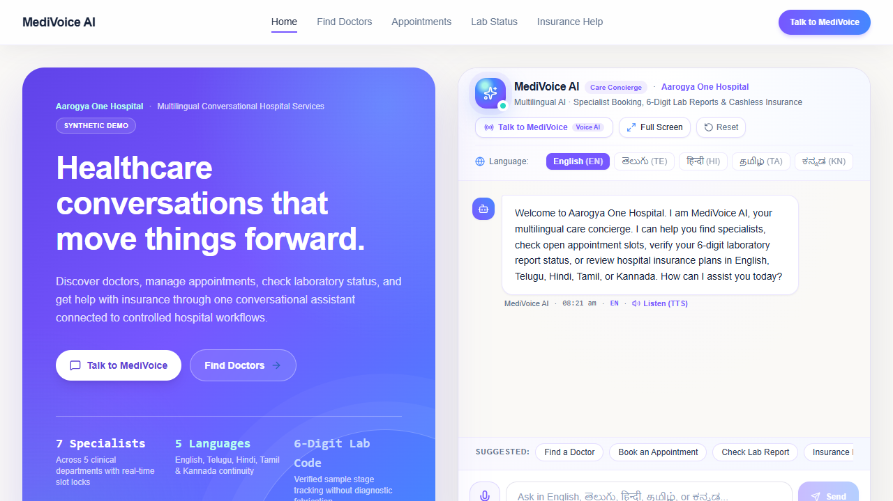
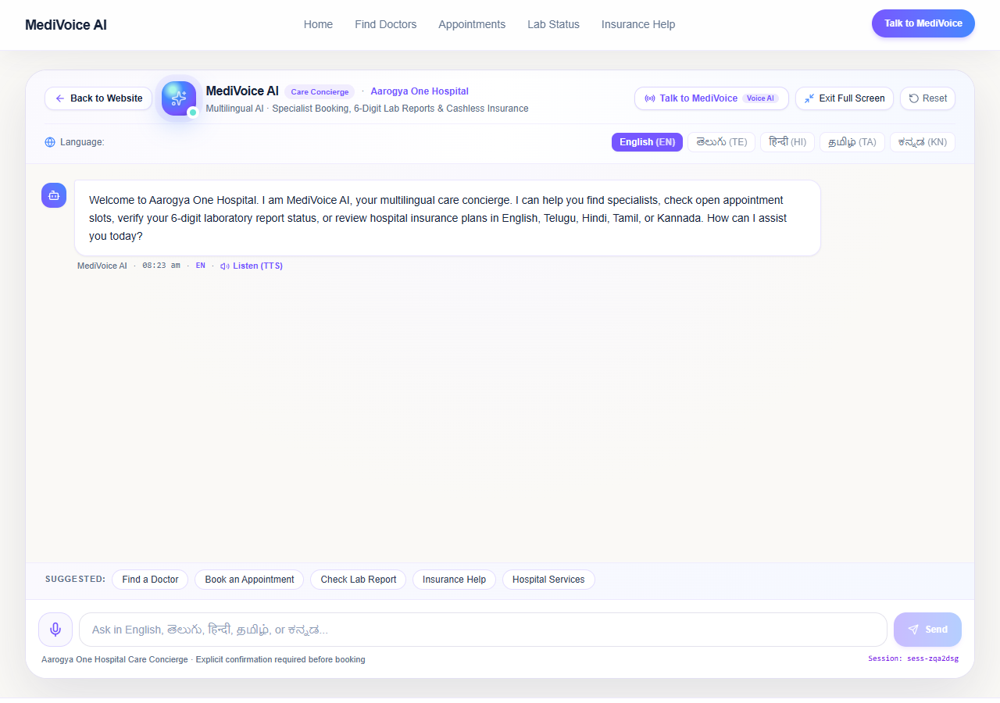
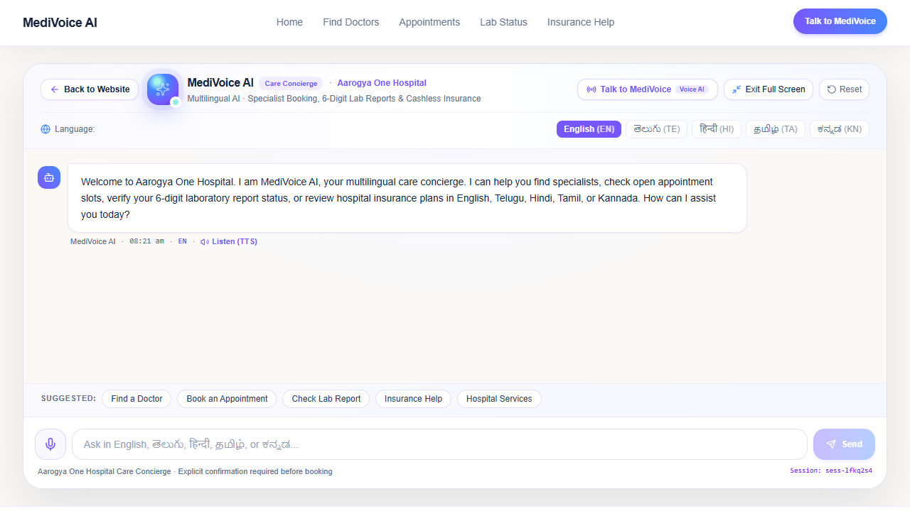
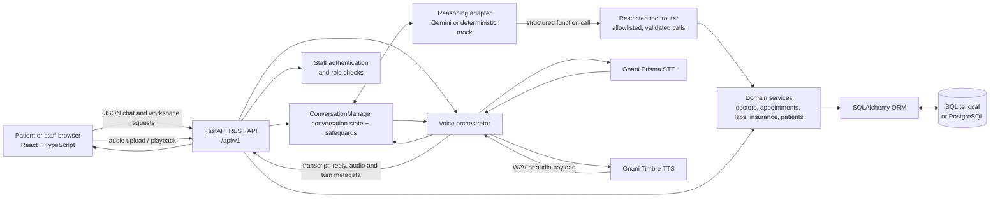

# MediVoice AI — Aarogya One Hospital Demo

[](https://www.python.org/)
[](https://fastapi.tiangolo.com/)
[](https://react.dev/)
[](https://www.typescriptlang.org/)
[](https://vite.dev/)

**Live demo:** [medivoice-ai-ochre.vercel.app](https://medivoice-ai-ochre.vercel.app) · **Repository:** [Venuk18/MediVoice](https://github.com/Venuk18/MediVoice)

MediVoice AI is a conversational hospital-operations demo for the fictional Aarogya One Hospital. A React patient and staff interface connects to a FastAPI backend that handles doctor discovery, appointment scheduling, lab-status verification, insurance information, and operational staff workflows. The assistant supports text and voice interactions in English, Telugu, Hindi, Tamil, and Kannada.

> **Demo and data notice:** The project is built around synthetic hospital data. It is not an electronic medical record (EMR), diagnostic system, or production-ready patient identity platform. Do not submit real patient information.

## Contents

- [Problem and approach](#problem-and-approach)
- [Implemented features](#implemented-features)
- [Screenshots](#screenshots)
- [Architecture](#architecture)
- [Technology](#technology)
- [Repository layout](#repository-layout)
- [Local setup on Windows](#local-setup-on-windows)
- [Configuration](#configuration)
- [Data model](#data-model)
- [Agent and booking workflow](#agent-and-booking-workflow)
- [Voice processing](#voice-processing)
- [HTTP API](#http-api)
- [Tests and current status](#tests-and-current-status)
- [Deployment](#deployment)
- [Security and privacy](#security-and-privacy)
- [Roadmap](#roadmap)
- [Contributing](#contributing)
- [License](#license)

## Problem and approach

Hospital service journeys often span separate systems and staff desks: a patient may need to find a specialist, identify an open appointment, check a lab order, or ask about an insurance plan. Switching between disconnected workflows adds friction, especially when the patient prefers to speak in a language other than English.

MediVoice brings these demo workflows together in one multilingual web experience. The assistant can call a small set of validated backend tools; the model does not receive direct database access. Appointment creation remains guarded by an explicit patient confirmation step, and the staff workspaces use role checks on protected backend operations.

## Implemented features

### Patient and assistant experience

- Hospital landing page, doctor directory, appointment booking and appointment lookup/cancellation flows.
- Text chat and voice interaction in English, Telugu, Hindi, Tamil, and Kannada.
- Doctor and specialty search, available-slot lookup, patient registration/verification tools, and appointment booking conversation.
- Booking review and explicit confirmation before the booking tool is executed.
- Lab-order status lookup using a six-digit verification code.
- Search of the seeded synthetic insurance provider and plan catalogue, plus a persisted support-ticket endpoint.
- An embedded assistant and a full-screen assistant route.

### Staff workspaces

- **Doctor:** appointment list, calendar/availability workflows, visit completion and follow-up recording.
- **Laboratory:** lab-order queue and supported status transitions.
- **Maintenance:** facilities work orders, status updates, doctor and insurance catalogue management, and workflow tickets/exceptions.
- Staff login issues signed bearer tokens with role claims. Protected operations use role checks; applicable roles include `DOCTOR`, `LAB_OPERATOR`, `MAINTENANCE_STAFF`, and `ADMIN`.

These are operational demo workflows over synthetic records. The application does not provide clinical diagnosis or a complete patient record system.

## Screenshots

The repository includes these application captures under [`backend/scripts/`](backend/scripts/). They are screenshots from the project, not generated mockups.

### Patient homepage with embedded assistant



### Full-screen assistant



### Assistant voice interface capture



## Architecture



Gemini and Gnani are optional external providers configured on the backend. In local development the reasoning adapter can be set to `mock`; provider credentials are never needed in the browser. The tool router validates names and arguments before invoking domain services.

## Technology

| Area | Technologies used |
|---|---|
| Backend | Python, FastAPI, Pydantic v2, SQLAlchemy 2, Alembic, HTTPX |
| Database | SQLite for local development and tests; PostgreSQL supported for deployment |
| Frontend | React 19, TypeScript, Vite, Tailwind CSS, Motion, Lucide icons |
| Reasoning | Gemini `generateContent` REST API or deterministic mock adapter |
| Speech | Gnani Prisma speech-to-text and Gnani Timbre text-to-speech, with development/test fallback behavior |
| Tests | pytest for backend; Node.js built-in test runner for frontend helper tests; TypeScript check and Vite production build |
| Hosting | Vercel-compatible frontend configuration; FastAPI backend can be hosted on Render |

## Repository layout

```text
.
├── backend/
│   ├── alembic/                  # Database migrations (0001 through 0004)
│   ├── app/
│   │   ├── agent/                # Conversation manager, adapters, state and tool router
│   │   ├── api/v1/               # Versioned FastAPI routes
│   │   ├── core/                 # Configuration and staff security
│   │   ├── db/                   # SQLAlchemy engine and sessions
│   │   ├── models/               # SQLAlchemy models
│   │   ├── schemas/              # Request/response schemas
│   │   └── services/             # Domain and speech services
│   ├── scripts/                  # Synthetic data, verification and evaluation utilities
│   ├── tests/                    # Backend pytest suite
│   ├── .env.example              # Backend configuration template
│   └── requirements.txt
├── frontend/
│   ├── src/
│   │   ├── app/                  # Application shell and platform context
│   │   ├── components/           # Navigation and shared controls
│   │   ├── features/             # Patient, chatbot, doctor, lab and maintenance screens
│   │   ├── hooks/                # Route/workspace state
│   │   ├── services/             # Typed API client
│   │   └── types/                # API/domain TypeScript types
│   ├── tests/                    # Focused frontend unit tests
│   ├── package.json
│   └── vercel.json
├── src/                          # Root Vite entry shim importing the frontend app
├── package.json                 # Root Vite wrapper package
├── vercel.json                  # Root Vercel SPA rewrite/security headers
└── README.md
```

The main frontend source and its test/build scripts are in `frontend/`. The root `src/` entry re-exports that application for the root Vite wrapper; it is not a separate hospital application.

## Local setup on Windows

### Prerequisites

- Python 3.11 or newer.
- Node.js 22 or newer (the frontend tests use Node's TypeScript stripping support).
- Git and PowerShell.

### 1. Prepare the backend

```powershell
cd backend
py -3 -m venv .venv
.\.venv\Scripts\Activate.ps1
python -m pip install --upgrade pip
python -m pip install -r requirements.txt
Copy-Item .env.example .env
```

Edit `backend\.env` for local development. Use SQLite and the mock reasoning adapter so development does not call Gemini. A minimal local configuration is:

```dotenv
DATABASE_URL=sqlite:///./medivoice.db
ENVIRONMENT=development
AI_PROVIDER=mock
LLM_PROVIDER=mock
ENABLE_DEMO_STAFF_AUTH=false
```

To exercise the synthetic staff login flow locally, set `ENABLE_DEMO_STAFF_AUTH=true` and restart the backend. Keep it disabled for production and never use demo accounts with real patient data.

Apply the local migrations and optionally add the synthetic demo catalogue:

```powershell
alembic upgrade head
python scripts\seed_data.py
```

The seed script writes synthetic records. Run it only against a local/demo database that is intended to contain this data.

Start the API from the `backend` directory:

```powershell
python -m uvicorn app.main:app --reload --host 127.0.0.1 --port 8001
```

The API docs are then available at [http://127.0.0.1:8001/docs](http://127.0.0.1:8001/docs), and the OpenAPI document at `http://127.0.0.1:8001/openapi.json`.

### 2. Prepare the frontend

Open a second PowerShell window:

```powershell
cd frontend
npm ci
npm run dev
```

Open [http://localhost:3000](http://localhost:3000). The Vite development server proxies `/api`, `/docs`, and `/openapi.json` to the local backend on port `8001`. For local development, `VITE_API_BASE_URL` can remain unset.

### Optional live AI and voice providers

The demo can use live providers when you configure server-side credentials. Set `AI_PROVIDER=gemini` and `GEMINI_API_KEY` in `backend\.env` to enable Gemini reasoning. Configure `GNANI_API_KEY` for live Gnani STT/TTS. Never put these values in a Vite `VITE_*` variable or commit a `.env` file. Live calls may incur provider usage.

## Configuration

Use [`backend/.env.example`](backend/.env.example) as the backend template and [`.env.example`](.env.example) as the root Vite wrapper template. The actual secret values belong only in an ignored local `.env` file or the hosting provider's secret manager.

### Backend variables

| Variable | Purpose | Typical local value / default |
|---|---|---|
| `DATABASE_URL` | SQLAlchemy database URL | `sqlite:///./medivoice.db` |
| `ENVIRONMENT` | Runtime environment; production requires a configured auth secret | `development` |
| `MEDIVOICE_AUTH_SECRET` | HMAC signing secret for staff bearer tokens | Set a long, random value; never use a demo value in production |
| `ENABLE_DEMO_STAFF_AUTH` | Enables synthetic demo staff authentication | `false`; only enable intentionally for a demo |
| `AI_PROVIDER` / `LLM_PROVIDER` | Selects the reasoning provider | `mock` locally, `gemini` for Gemini |
| `GEMINI_API_KEY` | Server-side Gemini credential | Secret; leave unset when using `mock` |
| `GEMINI_MODEL` | Gemini model identifier | `gemini-3.5-flash` |
| `GEMINI_TIMEOUT_SECONDS` | Provider request timeout | `15` seconds when unset; the supplied backend template sets `35` |
| `GEMINI_MAX_TOOL_ROUNDS` | Maximum reasoning/tool rounds per turn | `4` |
| `GEMINI_THINKING_LEVEL` | Gemini thinking setting used in request configuration | `low` |
| `GEMINI_ENABLE_FALLBACK` | Allows configured model fallback behavior | `false` |
| `GEMINI_MAX_RETRIES` | Bounded retries for transient Gemini HTTP/network errors | `2` (clamped to `0`–`5`) |
| `GEMINI_RETRY_BACKOFF_BASE` | Base exponential retry delay in seconds | `0.5` |
| `GNANI_API_KEY` | Server-side Gnani credential for speech services | Secret; optional for local mock/test paths |
| `GNANI_API_BASE` | Gnani service base URL | `https://api.vachana.ai` |
| `GNANI_STT_MODEL` / `GNANI_TTS_MODEL` | Speech model identifiers | `prisma-v3.0` / `timbre-v3.0` |
| `GNANI_TTS_VOICE` | Default TTS voice | `Shivani` |
| `GNANI_DEFAULT_LANGUAGE` | Default provider locale | `en-IN` |
| `VOICE_ENABLED` | Voice-enabled value returned by `/voice/config` | `true` |
| `VOICE_MAX_DURATION_SECONDS` | Maximum-duration value returned by `/voice/config` | `60` |
| `VOICE_REQUEST_TIMEOUT_SECONDS` | Speech provider request timeout | `20` seconds |
| `VOICE_DIAGNOSTICS_ENABLED` | Enables timing diagnostics in backend logs | `false` |
| `BACKEND_CORS_ORIGINS` | Allowed browser origins | JSON array or comma-separated origins |
| `API_V1_STR` | API prefix | `/api/v1` |

Some environment keys are consumed directly by provider services and are therefore not present in the Pydantic settings class. Confirm defaults in [`backend/app/core/config.py`](backend/app/core/config.py) and the service constructors before changing deployment values.

### Frontend variable

| Variable | Purpose | Example |
|---|---|---|
| `VITE_API_BASE_URL` | Backend origin; the typed API client appends `/api/v1` unless it is already present | `https://<your-render-service>.onrender.com` |

All `VITE_*` values are compiled into public browser assets. Do not put API keys, database credentials, or signing secrets in them.

## Data model

SQLAlchemy models are defined in [`backend/app/models/`](backend/app/models/), with schema history managed by Alembic. The current migration chain is:

`0001_initial_schema` → `0002_lab_insurance` → `0003_maintenance_work_orders` → `0004_create_patients_table`

| Model/table | Purpose and relationships |
|---|---|
| `Hospital` / `hospitals` | Demo hospital. Departments and doctors reference a hospital; insurance providers and maintenance orders also carry a hospital foreign key. |
| `Department` / `departments` | Hospital department; has doctors and may be referenced by lab orders. |
| `Doctor` / `doctors` | Active doctor directory entries tied to a hospital and department; owns appointment slots and is referenced by appointments. |
| `AppointmentSlot` / `appointment_slots` | Doctor availability. Unique constraint on `(doctor_id, start_time)`; one slot can be used by at most one appointment. |
| `Appointment` / `appointments` | Appointment state, reason and follow-up fields. References doctor and slot; `patient_reference` is stored as a string rather than a foreign key. |
| `Patient` / `patients` | Patient registration details with a unique patient reference. The current appointment and lab models also store references as strings; they do not declare ORM foreign-key relationships to this table. |
| `LabOrder` / `lab_orders` | Synthetic lab workflow/status metadata, verification-code state, expected completion and optional ordering department. No diagnostic result content is represented by the patient status endpoint. |
| `InsuranceProvider` / `insurance_providers` and `InsurancePlan` / `insurance_plans` | Synthetic provider/plan catalogue; plans reference a provider. |
| `MaintenanceWorkOrder` / `maintenance_work_orders` | Hospital-linked facilities and biomedical maintenance work items. |
| `WorkflowException` / `workflow_exceptions` | Operational workflow exception records with affected entity identifiers stored as metadata. |
| `AuditEvent` / `audit_events` | Audit history for operational actions; entity type and ID are recorded as fields. |

The Alembic migrations are intended to be applied with `alembic upgrade head`; do not rely on ORM table creation as a production migration strategy.

## Agent and booking workflow

1. The frontend sends a text turn to `POST /api/v1/agent/chat`, or sends audio to `POST /api/v1/voice/respond`.
2. The `ConversationManager` maintains language, conversation history, booking draft, pending action and confirmation state.
3. The selected reasoning adapter is Gemini or the deterministic mock adapter. Gemini can return structured function calls; it does not receive direct SQL/database access.
4. `RestrictedToolRouter` checks tool names and arguments against an allowlist, then calls application services with the server-managed SQLAlchemy session.
5. Doctor search and slot results update the conversation draft and offered choices. The patient must explicitly confirm before `book_appointment` is allowed to create the booking.
6. The API returns reply text, current workflow/confirmation state and tool trace. Voice requests also return audio when synthesis is enabled and successful.

The allowlisted agent tools are `search_doctors`, `get_available_slots`, `book_appointment`, `check_lab_report_status`, `search_hospital_insurance`, `register_patient`, and `verify_patient`.

## Voice processing

The browser uploads audio to the backend; provider credentials remain server-side.

1. The voice route validates and reads the upload, then calls `GnaniPrismaSTT` to obtain a transcript and language metadata.
2. The transcript is passed through the shared `ConversationManager` and the same restricted tool router as a text turn.
3. When synthesis is requested, `GnaniTimbreTTS` speaks the assistant reply. `/voice/respond` returns text and an optional base64 audio payload; `/voice/synthesize` returns WAV bytes directly.
4. The React voice panel plays returned audio and manages microphone/listening state. Text chat also has a Listen fallback that can synthesize a turn on demand.

The default language set is English, Telugu, Hindi, Tamil, and Kannada. Local tests mock speech provider responses; live provider testing is optional and may use paid quota. Two lower-latency endpoints (`/voice/respond/text` and `/voice/synthesize/stream`) are explicitly marked experimental in the API.

## HTTP API

The health endpoint is `GET /`. All other application routes below are prefixed by `/api/v1`. Interactive schemas are available from `/docs` and `/openapi.json` when the backend is running. Authentication and role requirements are enforced by individual handlers; the table notes the main access behavior rather than replacing the OpenAPI contract.

### Agent and voice

| Method | Path | Description |
|---|---|---|
| `POST` | `/agent/chat` | Process a text message and return conversation state, draft, tool trace and reply. |
| `GET` | `/agent/sessions/{session_id}` | Inspect an active session state. |
| `GET` | `/agent/config` | Return safe adapter/provider metadata and the approved tool list. |
| `POST` | `/agent/sessions/{session_id}/reset` | Reset an active conversation session. |
| `GET` | `/voice/config` | Return voice feature metadata and supported languages; does not return credentials. |
| `POST` | `/voice/transcribe` | Multipart audio upload and optional language hint; returns transcript and language metadata. |
| `POST` | `/voice/synthesize` | JSON text/language/voice/speed input; returns `audio/wav`. |
| `POST` | `/voice/respond` | Multipart audio turn; returns transcript, reply, workflow fields and optional base64 audio. |
| `POST` | `/voice/respond/text` | Experimental voice turn that skips TTS and returns text/metadata. |
| `POST` | `/voice/synthesize/stream` | Experimental server-sent events proxy for streamed TTS chunks. |

### Hospitals, doctors and appointments

| Method | Path | Description |
|---|---|---|
| `GET` | `/hospitals` | List hospitals. |
| `GET` | `/hospitals/{hospital_id}` | Read hospital details and active departments. |
| `GET` | `/doctors` | List active doctors; supports specialty, department and hospital filters. |
| `POST` | `/doctors` | Add a doctor and initial slots; staff-protected. |
| `DELETE` | `/doctors/{doctor_id}` | Deactivate a doctor; staff-protected. |
| `GET` | `/doctors/{doctor_id}` | Read a doctor profile. |
| `GET` | `/doctors/{doctor_id}/slots` | List open slots with date/time filters. |
| `POST` | `/doctors/{doctor_id}/slots` | Add availability; staff-protected. |
| `POST` | `/appointments` | Create an appointment through the validated booking service. |
| `GET` | `/appointments` | List/filter appointments; staff access is checked by the route. |
| `GET` | `/appointments/{appointment_id}` | Read by opaque appointment ID; the route treats the identifier as a bearer capability. |
| `POST` | `/appointments/{appointment_id}/cancel` | Cancel an appointment and release its slot according to service rules. |
| `POST` | `/appointments/{appointment_id}/complete` | Mark a visit complete; staff-protected. |
| `POST` | `/appointments/{appointment_id}/follow-up` | Record a follow-up recommendation; staff-protected. |

### Authentication and staff

| Method | Path | Description |
|---|---|---|
| `GET` | `/auth/demo-accounts` | List synthetic staff profile names and roles without credentials. |
| `POST` | `/auth/login` | Authenticate a staff account and issue a signed bearer token. |
| `GET` | `/auth/me` | Return the authenticated staff profile. |

### Laboratory, insurance and support

| Method | Path | Description |
|---|---|---|
| `GET` | `/lab-orders` | Staff lab queue metadata; excludes verification codes. |
| `POST` | `/lab-orders` | Create a synthetic lab order and verification code; staff access checked. |
| `POST` | `/lab-orders/verify-status` | Verify a six-digit patient code and return permitted status metadata. |
| `GET` | `/lab-orders/demo/patient-portal/{patient_reference}` | Staff-only synthetic patient-portal utility. |
| `GET` | `/lab-orders/{order_id}` | Read lab-order metadata without returning the code. |
| `PATCH` | `/lab-orders/{order_id}/status` | Update a lab workflow status; staff-protected. |
| `GET` | `/insurance/providers` | List active synthetic providers and plans. |
| `POST` | `/insurance/providers` | Add a provider/plan; staff-protected. |
| `DELETE` | `/insurance/providers/{provider_id}` | Deactivate a provider; staff-protected. |
| `GET` | `/insurance/providers/{provider_id}/plans` | List a provider's active plans. |
| `GET` | `/insurance/search` | Search synthetic provider and plan information. |
| `GET` | `/insurance/contact` | Return configured synthetic helpdesk details. |
| `POST` | `/insurance/support-tickets` | Create a persisted insurance support request. |
| `GET` | `/insurance/support-tickets` | List support tickets; staff-protected. |

### Maintenance and workflow intelligence

| Method | Path | Description |
|---|---|---|
| `GET` | `/maintenance/summary` | Return maintenance work-order summary metrics. |
| `GET` | `/maintenance/work-orders` | List/filter work orders; maintenance staff or admin. |
| `GET` | `/maintenance/work-orders/{work_order_id}` | Read a work order. |
| `POST` | `/maintenance/work-orders` | Create a work order; staff-protected. |
| `PATCH` | `/maintenance/work-orders/{work_order_id}/status` | Apply a validated work-order transition. |
| `GET` | `/workflow/exceptions` | List workflow exceptions. |
| `POST` | `/workflow/exceptions/detect` | Run deterministic overdue lab-order detection. |
| `POST` | `/workflow/exceptions/{exception_id}/assign` | Assign an exception and move it into progress. |
| `POST` | `/workflow/exceptions/{exception_id}/resolve` | Resolve an exception with a finding note. |
| `GET` | `/workflow/audit-events` | Filter operational audit events. |

## Tests and current status

Run backend tests from `backend/`. Set the provider to `mock` for a local, offline test run:

```powershell
cd backend
$env:AI_PROVIDER = "mock"
try {
    .\.venv\Scripts\python.exe -m pytest tests -q
} finally {
    Remove-Item Env:AI_PROVIDER -ErrorAction SilentlyContinue
}
```

Run frontend checks from `frontend/`:

```powershell
cd frontend
npm test
npm run lint
npm run build
```

**Recorded local status (2026-11-02):** Backend collected 255 tests: **254 passed, 1 failed**. The known failure is `test_doctor_preference_change_in_telugu`; it expects a recommended doctor to be assigned to the booking draft before the patient accepts the suggestion. The current flow intentionally leaves that choice pending. This mismatch is documented and is not presented as a passing suite. The focused Gemini resiliency/voice confirmation/booking safeguard run passed **10 tests**. Frontend tests passed **7/7**, TypeScript lint passed, and the production build passed with a Vite `__dirname` configuration warning.

Provider credentials are not required for the focused tests. Avoid running live provider evaluation scripts unless you intend to send synthetic audio/text to those services and use their quota.

## Deployment

The repository includes Vercel SPA rewrite configuration at the root and in `frontend/`; it does not include a Render Blueprint. Configure the services in their dashboards and keep credentials in provider-managed environment settings.

### Render backend

1. Create a Render **Web Service** for this repository. Set the service root directory to `backend`.
2. Configure build command `pip install -r requirements.txt` and start command `uvicorn app.main:app --host 0.0.0.0 --port $PORT`.
3. Attach the intended PostgreSQL database and set `DATABASE_URL` using Render's connection value. Keep it private.
4. Configure `ENVIRONMENT=production`, a strong unique `MEDIVOICE_AUTH_SECRET`, `AI_PROVIDER=gemini` (if live reasoning is intended), `GEMINI_API_KEY`, and the chosen `GEMINI_MODEL`. Configure `GNANI_API_KEY` only if live speech is intended. Set `ENABLE_DEMO_STAFF_AUTH=false` unless a synthetic demo explicitly requires it.
5. Set `BACKEND_CORS_ORIGINS` to the exact Vercel application origins that should call the API.
6. Run `alembic upgrade head` as a controlled pre-deploy/release command before serving application traffic. Verify migrations and backups through the normal database operations process.

The app's API docs are normally served at `/docs`; disable or restrict public documentation if your deployment policy requires it. Do not run the synthetic seed script against real patient data.

### Vercel frontend

1. Import the repository into Vercel and set the project root directory to `frontend` (or use the root wrapper if that is how the existing Vercel project is configured).
2. Use the Vite build command `npm run build` and output directory `dist`.
3. Set `VITE_API_BASE_URL` to the backend origin, for example `https://<your-render-service>.onrender.com`. The frontend client adds `/api/v1` automatically.
4. Redeploy after changing build-time frontend variables. Verify browser requests reach the intended backend and that its CORS allowlist includes the deployed frontend origin.

## Security and privacy

- Use synthetic records only. The project does not provide a complete verified patient identity flow or an EMR security boundary.
- Appointment lookup/cancellation can use an opaque appointment identifier as a bearer capability. Anyone who obtains that identifier may be able to access the corresponding flow; it is not proof of identity.
- Staff endpoints use signed bearer tokens and role checks. `MEDIVOICE_AUTH_SECRET` must be unique and strong in production. Demo staff authentication is intended for demonstration only.
- Gemini and Gnani credentials belong only on the backend. Never store them in frontend code, `VITE_*` variables, screenshots, logs, or Git.
- Patient audio/transcripts may be sent to configured external AI/speech providers. Obtain appropriate consent and review provider data handling before enabling live services.
- Voice diagnostics are opt-in (`VOICE_DIAGNOSTICS_ENABLED=false` by default). Keep diagnostics and retention aligned with your privacy requirements.
- Keep the database private, rotate credentials, restrict CORS, and use TLS for deployed services. Do not use the local/demo auth secret or demo accounts with real patient data.
- The assistant is for operational workflows, not medical diagnosis or treatment decisions.

## Roadmap

The items below are **possible future work, not implemented capabilities or delivery commitments**:

- Add a verified patient identity and authorization flow before exposing real patient records or appointment management.
- Replace synthetic demo staff access with an organization-managed identity provider and production credential lifecycle.
- Expand browser-level accessibility, voice-device, and multilingual workflow coverage.
- Define production data-retention, consent, audit-review, and external-provider governance policies before any real-data use.

## Contributing

Contributions should stay within the synthetic-demo scope unless the maintainers explicitly approve a broader change. For a pull request:

1. Open an issue describing the user-visible problem or proposed change.
2. Keep secrets, real patient data, and generated build artifacts out of commits.
3. Add focused tests for behavior changes and run the backend/frontend checks above.
4. Describe any provider usage, migration, environment-variable, or security implications in the pull request.

There is no separate `CONTRIBUTING.md` at this time.

## License

No `LICENSE` file is present in the repository. Reuse and redistribution terms are therefore not specified here; contact the repository owner before treating the code as open source.
